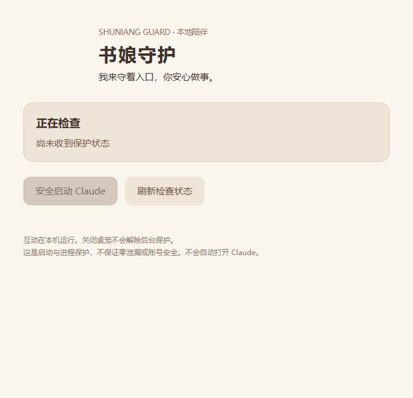

# 书娘守护 · Shuniang Guard

一个会回应、能摸头和拖动的橙发书娘桌宠，为 Windows 上的 Claude 桌面应用增加节点与分流检查。基于 [dsh-pet 独立应用模式](https://github.com/PC2005-cloud/dsh-pet)，不依赖 DeepSeek Harness，不需要模型密钥。



**当前版本为 0.1.0 预发布。真实 Claude 启动与运行兼容性尚未测试；开发和验收全过程不启动 Claude。** 先使用演示版了解交互，不要把界面显示当作网络安全保证。

## 能做什么

- 点击打招呼、拖拽/抛掷、摸头表情、一起读书、状态气泡。
- 小书娘启动、单击、双击和摸头均不会打开 Claude。只有保护面板中的明确操作才请求受保护启动。
- Claude.exe 的 IFEO 启动入口保持拦截；保护器或桌宠未运行时也不主动移除拦截。
- 启动前重新检查实时配置和出口；后台持续检查，失败时锁定入口并结束受保护的 Claude 包进程。
- 不修改 ChatGPT、Codex、Antigravity 的 AIAppVpnGuard 程序、任务或 IFEO 项。
- 桌宠交互完全在本地运行。此分支的模型传输层被替换为明确拒绝请求的实现。

## 检查条件

1. FlClashCore、FlClash TUN 网卡及公网 IPv4 最佳路由正常。
2. Mihomo 本机控制接口可读；当前生效模式必须是 rule。
3. Claude 专用策略组只含一个已批准节点，实时选择与基线一致，禁止 DIRECT/自动回落。
4. 四条 DOMAIN-SUFFIX 规则必须位于所有其他规则之前：anthropic.com、claude.ai、claude.com、claudeusercontent.com；同时验证运行中核心的规则。
5. DNS Fake-IP、UDP/TCP 53 劫持开启；本版要求 IPv6 关闭。
6. 节点完整传输配置的摘要匹配批准基线。
7. 通过本机代理连接固定的中立 HTTPS 探针 `www.cloudflare.com/cdn-cgi/trace`，结合 `/connections` 校验实际代理链，再比较批准的出口 IP 与地区。此检查不访问 Claude 域名。
8. 检查期间配置保持一致。任何未知、超时、错误、缺失或过期证据均拒绝启动。

这是一套保守策略。复杂订阅组、IPv6 代理、多节点切换及额外登录域名需要另行扩展和验证，不能通过删除检查项来冒充支持。

## 使用演示版

在 Windows 解压 Release ZIP，双击 `预览书娘.cmd`。该入口将 Claude 启动能力硬性禁用，不安装系统保护、不改 VPN。素材与代码来源见 [NOTICE.md](NOTICE.md)。

保护版 `书娘守护.cmd` 只显示真实后台状态；未安装后台时保持锁定。

## 本机保护安装

当前安装器是**从已有 ClaudeVpnGuard 的迁移工具**，会检查旧任务身份；不支持盲目覆盖其他保护器。安装需管理员权限，全部脚本仅使用 PowerShell 7。

1. 备份旧程序、Claude.exe IFEO、任务 XML、桌面快捷方式和校验清单。
2. 建立只保存在本机的策略：见 [policy.example.json](policy.example.json)。`enrolled:false` 的示例永远不放行。不能用别人的出口 IP、节点摘要或路径。
3. 在 FlClash 开启仅本机 External Controller；保持 TUN 和当前节点不变。填写控制地址，密钥从本机生效配置读取，不复制进仓库。
4. 构建完成后，在管理员 PowerShell 7 中运行 `scripts/Install-Guard.ps1 -PolicyPath <本机策略绝对路径>`。安装器先用无网络探针验证拦截/放行，再只停用旧 Claude 任务并安装新后台。
5. 查看 `C:\ProgramData\ShuniangGuard\status.json` 和书娘面板。控制接口不可用时会明确锁定。

FlClash 0.8.92 的界面路径为「工具 → 基础配置 → 外部控制器」，开启后监听 `127.0.0.1:9090`。不要为了启用检查而关闭 TUN 或切换节点。

后续更新：构建后在管理员 PowerShell 7 中执行 `scripts/Update-Guard.ps1`。更新器先备份，只替换本保护器的三个运行文件，保持 IFEO 拦截并核对其他应用保护未变；失败时恢复旧文件。

回滚：管理员 PowerShell 7 执行 `scripts/Restore-Guard.ps1`，恢复旧 Claude 任务与尚未被另改的快捷方式，保留程序和备份。不会修改其他应用的保护。

## 从源码构建

Windows x64、Node.js 22.12+、PowerShell 7。

```powershell
npm ci
npm test
npm run build
pwsh -NoLogo -NoProfile -File scripts/Build-Guard.ps1
npm run preview
```

依赖版本由 `package-lock.json` 固定。`vendor/dsh-pet` 为固定上游代码快照，构建脚本对桌面入口应用可重复的适配。完整构建与打包脚本在 `scripts/`。

## 边界

- 不是网络层 kill switch，不保证零泄漏、地区政策适用性或账号安全。
- 后台为轮询；断线与检测之间存在时间窗口。进程终止可能丢失未保存内容。
- 中立探针证明它自己的出口和链路，不是对 Claude 服务的端到端访问测试。
- 仅支持既定 Windows Claude 包路径；网页版、CLI、改名程序及其他设备不在覆盖范围。
- IFEO 拦截/调试脱离通过无网络替身验证；未启动真实 Claude，真实客户端兼容性为 **NOT_RUN**。
- 本地管理员可以更改保护配置；这不是抵御管理员攻击的安全边界。

验证记录见 [docs/VALIDATION.md](docs/VALIDATION.md)。推广文字见 [docs/推广文案.md](docs/推广文案.md)，请以实际验证范围介绍功能。
