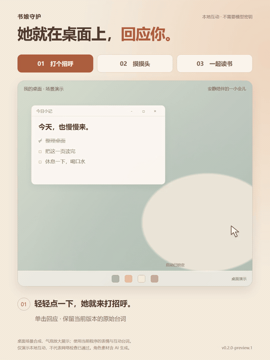
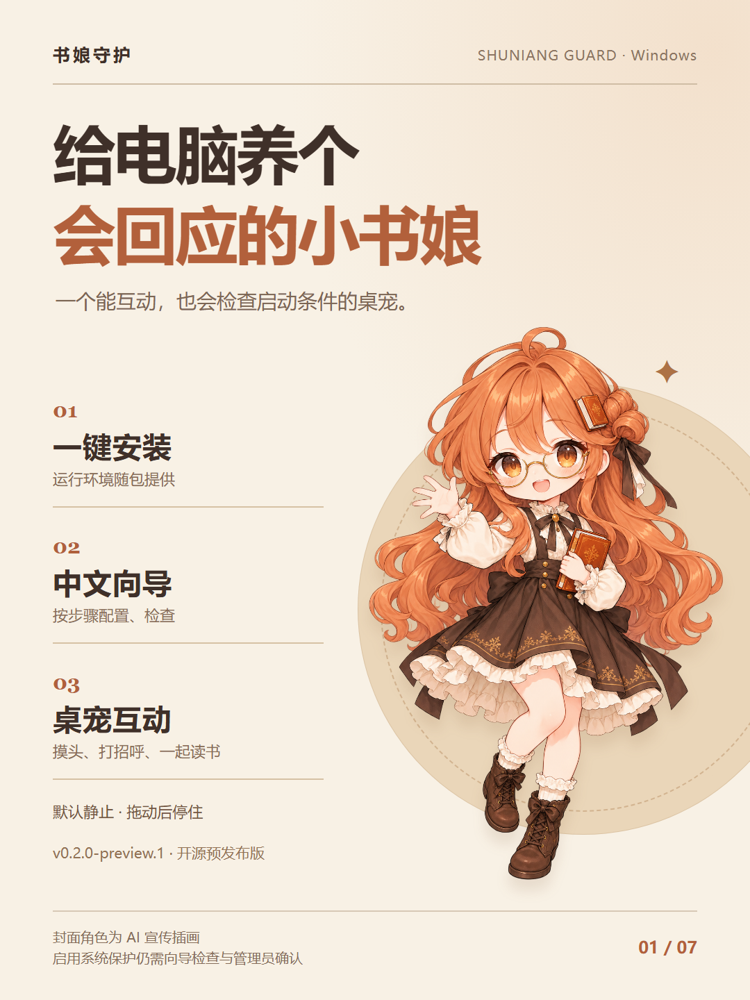
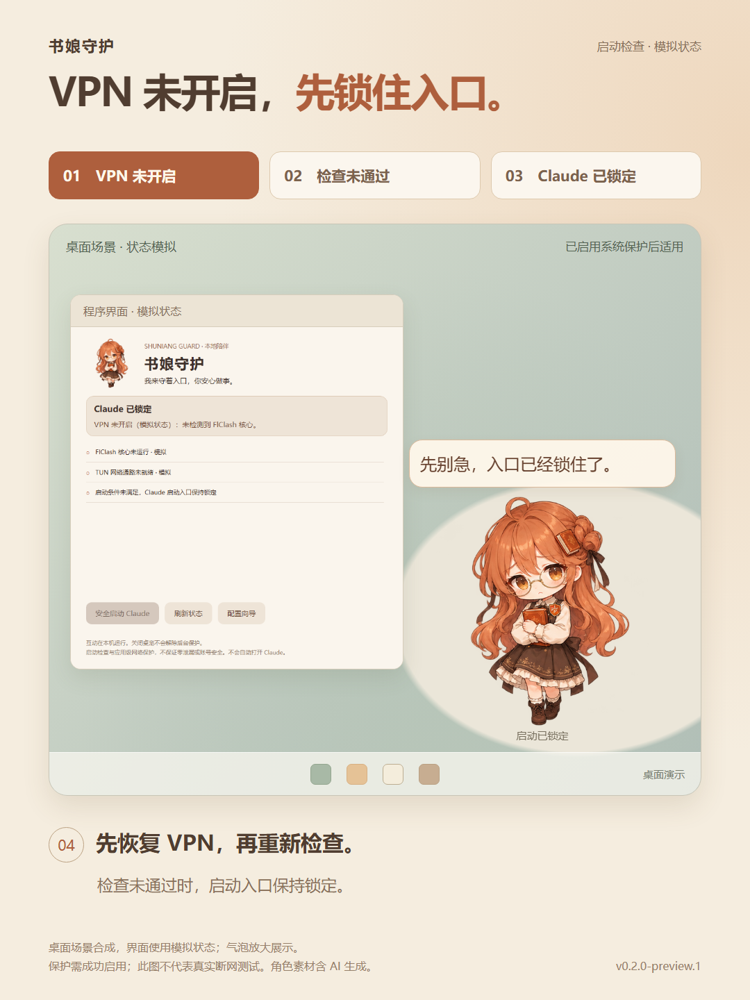

# 书娘守护 · Shuniang Guard

一个可以摸头、打招呼、陪你读书的 Windows 桌宠，提供中文配置向导和 Claude 启动前检查。

**[下载安装包](https://github.com/Eclipse017/ShuniangGuard/releases/download/v0.2.0-preview.1/ShuniangGuard-0.2.0-preview.1-Setup.exe)** · **[下载图文素材包](https://github.com/Eclipse017/ShuniangGuard/releases/download/v0.2.0-preview.1/ShuniangGuard-Promo-v0.2.0.zip)** · [使用教程](docs/USER-GUIDE.md) · [常见问题](docs/FAQ.md)

18 秒看三种互动：[高清 MP4](https://github.com/Eclipse017/ShuniangGuard/releases/download/v0.2.0-preview.1/ShuniangGuard-Interaction-v0.2.0.mp4) · [完整动画素材包](https://github.com/Eclipse017/ShuniangGuard/releases/download/v0.2.0-preview.1/ShuniangGuard-Interaction-Demo-v0.2.0.zip)。桌面为合成场景，使用当前版本的表情与台词。

查看封面

## 一键安装，中文上手

- **运行环境已打包**：下载安装程序即可，无需另装运行环境或旧版保护程序。
- **中文向导**：读取节点、备份专属分流、检查出口，再确认启用保护。
- **本地互动**：点击打招呼、摸头回应、右键一起读书；拖动松手后停住。
- **桌宠可随时退出**：已经启用的后台保护独立运行。

当前版本为 **0.2.0-preview.1 预发布版**。全新电脑的系统保护安装与真实 Claude 运行兼容性尚未完成完整验证。安装器未签名，启用系统保护需要管理员确认。

## 使用教程

1. **确认环境**：Windows x64、FlClash / Mihomo、Windows 商店版 Claude；配置中需要独立节点。
2. **安装应用**：双击安装包，点击「安装并打开配置向导」。
3. **连接本机接口**：在 FlClash 开启外部控制器，监听 `127.0.0.1:9090`，保持规则模式与 TUN。详细兼容条件见[教程](docs/USER-GUIDE.md#使用条件)。
4. **选择并检查**：读取节点，备份并配置专属分流，再检查出口地区和配置。
5. **启用保护**：所有检查通过后，确认管理员提示并等待成功状态；选择显示或退出书娘。

**安装、配置、普通点击和摸头均不会自动打开 Claude。** 应用安装完成不等于系统保护已启用；请以向导的成功状态为准。

只想体验桌宠，可以下载[完整 ZIP](https://github.com/Eclipse017/ShuniangGuard/releases/download/v0.2.0-preview.1/ShuniangGuard-0.2.0-preview.1-win-x64.zip)，解压后运行「预览书娘.cmd」。

[查看完整教程与排查方法 →](docs/USER-GUIDE.md)

## 启动前会检查什么

系统保护启用后，会核验节点、实时分流、出口 IP 与地区、TUN 路由，以及 Claude 专用网络规则。失败、超时或无法确认时，按策略拒绝启动。

查看：VPN 未开启时，Claude 启动入口保持锁定

使用程序界面与模拟状态制作，保护需成功启用后生效；此图不代表真实断网测试。

网络规则用于限制受保护的 Claude 应用绕过指定通路直接联网。中立探针只核验自身出口链路，不代表 Claude 服务端到端可用，也不能认证账号或所在地资格。

这不是防封号工具，不保证零泄漏或账号安全。网页版、CLI、Cowork 虚拟机及其他设备不在完整覆盖范围内。[适用范围与保护说明 →](docs/FAQ.md)

## 图文与使用资料

| 内容 | 打开或下载 |
| --- | --- |
| 7 张配图：封面、功能、教程、适用范围 | [在线查看](docs/promotion/README.md) |
| 标题与正文 | [可直接复制的文案](docs/promotion/COPY.md) |
| 图文素材包 | [下载 ZIP](https://github.com/Eclipse017/ShuniangGuard/releases/download/v0.2.0-preview.1/ShuniangGuard-Promo-v0.2.0.zip) |
| 互动视频与动画素材（含 VPN 未开启截图） | [MP4](https://github.com/Eclipse017/ShuniangGuard/releases/download/v0.2.0-preview.1/ShuniangGuard-Interaction-v0.2.0.mp4) · [完整 ZIP](https://github.com/Eclipse017/ShuniangGuard/releases/download/v0.2.0-preview.1/ShuniangGuard-Interaction-Demo-v0.2.0.zip) |
| 安装包、便携包与校验文件 | [版本发布页](https://github.com/Eclipse017/ShuniangGuard/releases/tag/v0.2.0-preview.1) |

图中界面来自程序演示截图，示例路径与节点不是实际用户配置。封面角色为 AI 宣传插画。

## 开源与署名

基于 [dsh-pet](https://github.com/PC2005-cloud/dsh-pet) 独立版，按 [MIT License](LICENSE) 开源。角色素材含 AI 生成，第三方代码保留原许可。

书娘守护是非官方项目，与 Anthropic、Claude、DeepSeek 无隶属或背书关系。[素材与许可说明](NOTICE.md)
