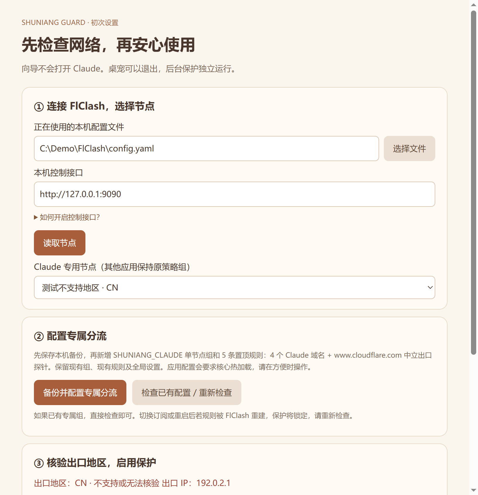

# 书娘守护 · Shuniang Guard

为 Windows Claude 桌面应用增加启动前检查，也可以养一只会回应的小书娘。基于 [dsh-pet 独立版](https://github.com/PC2005-cloud/dsh-pet)，互动在本地运行，无需模型密钥。

[下载独立安装包](https://github.com/Eclipse017/ShuniangGuard/releases/tag/v0.2.0-preview.1) · [验证记录](docs/VALIDATION.md) · [素材与许可](NOTICE.md)

**0.2.0-preview.1 是预发布版。** 已验证隔离目录解压、文件校验、中文向导、策略反例和离线启动替身；全新机器上的系统服务安装、真实 Claude 客户端兼容性仍待验证。开发与测试全程没有打开 Claude。

## 普通用户安装

1. 下载 ShuniangGuard-0.2.0-preview.1-Setup.exe，双击「安装并打开配置向导」。自带 Electron、Node.js、PowerShell 7，不依赖旧版 ClaudeVpnGuard。
2. 在 FlClash 开启仅本机外部控制器，常见路径是「工具 → 基础配置 → 外部控制器」，监听 127.0.0.1:9090。保持 TUN 开启。不同版本界面可能不同；如需重启核心，请自行选择合适时间。
3. 在中文向导读取本机 YAML 配置，选择独立节点。点击「备份并配置专属分流」，或检查已有配置。备份路径显示在向导中，包含私人配置，请勿上传。
4. 点击检查，确认出口地区、节点和分流全部通过，再点击「启用系统保护」。Windows 会请求管理员确认。**安装不会打开 Claude。**
5. 启用成功后，可选择显示书娘，也可直接退出。后台保护继续运行。之后由用户自行点击「Claude（受保护）」快捷方式或面板的启动按钮。

安装器尚无发布者代码签名。请只从本仓库 Release 下载，并对照 SHA256SUMS.txt；组织安全策略不允许运行时，请交管理员处理。

ZIP 解压后可运行「配置向导.cmd」；「预览书娘.cmd」禁用系统修改和 Claude 启动，只体验桌宠与面板。安装版可在 Windows「已安装的应用」卸载。卸载只移除本程序登记的启动保护，以及本次独立安装创建的网络规则；复用的外部网络保护保留。恢复记录保存在 ProgramData。桌面「Claude（受保护）」快捷方式若已无目标，可自行删除。

### 当前支持范围

- Windows x64、FlClash / Mihomo、Windows 商店版 Claude；网络适配器名为 FlClash，描述包含 Meta。
- YAML 中有独立节点定义；只有 provider 引用的订阅不支持。
- 规则模式、TUN、Fake-IP、TCP/UDP DNS 劫持均开启，IPv6 关闭。这些全局设置由用户在 FlClash 中配置，向导不会替你调整。
- Claude 安装位于 C:\Program Files\WindowsApps 或 D:\WindowsApps。网页版、CLI、其他设备及 Cowork 虚拟机不在已验证范围。
- 已有 ClaudeVpnGuard / 其他启动保护器时拒绝覆盖，不要求先安装旧程序。旧版本迁移脚本仍为维护人员保留，普通用户使用中文向导即可。

## 怎样保护

用户请求启动后，门禁依次核验核心/TUN/路由、单一节点、实时分流与 DNS、中立探针出口与地区、独立 WFP 网络规则。全部通过才放行；失败、未知或过期就锁定。

启动门禁使用 Windows IFEO，桌宠退出不会解除拦截。后台持续复核；发现失效会锁定新启动并结束受保护的 Claude 包进程，可能丢失未保存内容。WFP 网络层仅匹配 Claude 包及其进程，允许指定 TUN 和本机代理，阻止其他网卡直连；不修改其他应用的保护规则。

地区检查通过固定中立 HTTPS 地址 www.cloudflare.com/cdn-cgi/trace，结合本机控制接口核验实际代理链。它检查批准节点的出口 IP 与国家/地区；不是访问 Claude 的端到端测试，也不能替代账号或所在地资格判定。

地区名单依据 [Claude 官方可用地区说明](https://support.claude.com/en/articles/8461763-where-can-i-access-claude)，核对日期 **2026-10-25**。无法仅用国家代码区分的部分地区保守拒绝。本版名单于 **2027-01-23 UTC** 过期，之后锁定并需要更新版本。即使出口地区在名单内，节点摘要、批准的 IP、专属规则等任一不匹配仍拒绝启动。

向导只新增 SHUNIANG_CLAUDE 单节点组，以及置顶的 4 条 Claude 域名规则与 1 条中立探针规则。原组、原规则、全局节点选择与其他配置保留；写入前检查文件未被并行修改，热加载失败尝试恢复备份。已有同名组时拒绝覆盖。FlClash 重建配置或切换订阅可能移除这些规则，届时保护锁定，需要重新配置并检查。

网络层实现与验证边界见 [网络保护说明](docs/CLAUDE-NETWORK-GUARD.md)。它不是零泄漏或防封号保证，本地管理员可以更改保护。

## 小书娘

点击打招呼、摸头、一起读书、拖动位置。默认保持静止，仅有轻微呼吸；拖动松手后停住，不抛掷、不自动游走。系统设置减少动画时取消呼吸位移。

普通点击、摸头、安装和配置都不会打开 Claude。启动按钮是单独的明确操作。

## 从源码构建

开发环境：Windows x64、Node.js 22.12+、PowerShell 7、Windows .NET Framework 编译器。

~~~powershell
npm ci
npm test
npm run build
pwsh -NoLogo -NoProfile -File scripts/Build-Guard.ps1
pwsh -NoLogo -NoProfile -File scripts/Build-NetworkGuard.ps1
pwsh -NoLogo -NoProfile -File scripts/Build-Installer.ps1
pwsh -NoLogo -NoProfile -File scripts/Fetch-Runtime.ps1
pwsh -NoLogo -NoProfile -File scripts/Package.ps1
~~~

测试均使用离线替身、模拟配置与隔离安装目录。真实 Claude、真实 VPN 中断、全新机器服务安装及重启验证为 **NOT_RUN**。不要把局部测试或演示截图宣传成完整客户端联调成功。

[小红书文案草稿](docs/推广文案.md)提供可编辑文字，本项目不会替你发布内容。
