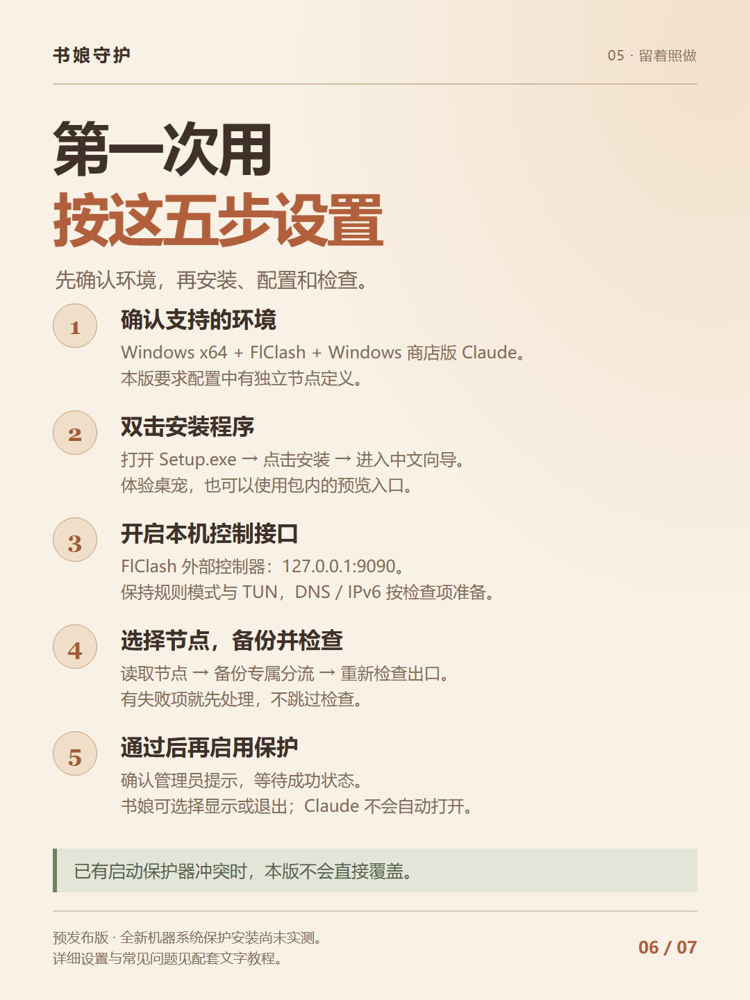

# 使用教程

[下载安装包](https://github.com/Eclipse017/Claude-VPN-Guard/releases/download/v0.2.0-preview.1/ShuniangGuard-0.2.0-preview.1-Setup.exe) · [返回首页](../README.md) · [常见问题](FAQ.md)

## 使用条件

当前版本：**0.2.0-preview.1**。

- Windows x64、FlClash / Mihomo、Windows 商店版 Claude。
- Claude 安装在 `C:\Program Files\WindowsApps` 或 `D:\WindowsApps`。
- YAML 中具有独立节点定义；仅有 provider 引用的订阅暂不支持。
- FlClash 的规则模式、TUN、Fake-IP、TCP/UDP DNS 劫持已开启，IPv6 关闭。
- 网络适配器名称为 FlClash，描述包含 Meta。

向导不会替你调整全局节点、DNS 或 IPv6 设置。如果当前环境不满足，可以先体验桌宠，不必为试用而改动其他应用正在使用的配置。

## 1. 安装应用

下载发布页中的 `ShuniangGuard-0.2.0-preview.1-Setup.exe`，双击后选择「安装并打开配置向导」。

运行环境已包含在安装包中，无需先装旧版 ClaudeVpnGuard。安装器未签名，请核对来源和发布页的校验文件。组织安全策略不允许运行时，请交管理员处理。

应用安装和系统保护启用是两个步骤。安装程序不会自动打开 Claude。

## 2. 开启本机控制接口

FlClash 的常见路径为「工具 → 基础配置 → 外部控制器」，不同版本的名称可能略有不同。

监听 `127.0.0.1:9090`，不要监听 `0.0.0.0`。保持规则模式与 TUN 开启；如需重启核心，请选择方便的时间。

## 3. 选择专用节点

在向导中选择当前生效的本机 YAML 配置，填写本机接口地址，点击「读取节点」。

从列表选择 Claude 专用的独立节点。接口密钥由程序从本机配置读取，无需上传或复制到仓库。

## 4. 备份分流并检查

点击「备份并配置专属分流」。向导先保存原配置，再添加专属单节点组与 5 条置顶规则：4 条 Claude 域名规则、1 条中立出口探针规则。

已有组、已有规则与全局配置保留；应用配置会请求核心热加载。备份位置会显示在向导中，文件可能包含私人配置，请妥善保存。

如果已有专属组，点击「检查已有配置 / 重新检查」即可。配置未通过时，先按提示排查，不跳过检查。

## 5. 启用系统保护

检查全部通过后，点击「启用系统保护（管理员确认）」，确认 Windows 管理员提示，等待向导显示成功。

再选择是否显示书娘。退出桌宠不会解除已经启用的后台保护。

如果发现旧启动保护器或同名保护组件冲突，本版会停止覆盖操作，请保留原保护并参考其迁移说明。

## 桌宠互动

| 操作 | 效果 |
| --- | --- |
| 单击 | 打招呼 |
| 在头部来回移动指针 | 摸头回应 |
| 右键菜单 | 摸摸头、一起读书、打招呼或查看状态 |
| 拖动 | 调整位置，松手后停住 |
| 退出桌宠 | 已启用的后台保护继续运行 |

普通点击、摸头、安装与配置均不会自动打开 Claude。启动操作位于单独的受保护入口。

## 仅体验与卸载

**仅体验桌宠**：下载[完整 ZIP](https://github.com/Eclipse017/Claude-VPN-Guard/releases/download/v0.2.0-preview.1/ShuniangGuard-0.2.0-preview.1-win-x64.zip)，解压后运行「预览书娘.cmd」。该入口禁用系统修改与 Claude 启动。

**卸载安装版**：先退出书娘，再从 Windows「已安装的应用」卸载。只移除本次安装登记的保护；复用的独立网络规则保留。恢复资料保留在 ProgramData。

## 检查没通过

| 提示或现象 | 处理方式 |
| --- | --- |
| 控制接口不可读 | 确认接口已开启、地址为本机、所选文件为生效配置 |
| 找不到独立节点 | 本版暂不支持只有 provider 引用的配置 |
| 分流规则不一致 | 切换订阅或配置重建后，重新配置并检查 |
| 出口 IP 或地区变化 | 重新核验本机基线，不删除检查项 |
| 已有保护器冲突 | 保留原保护，按原程序的迁移说明处理 |

## 版本说明

本版仍为预发布，真实 Claude 运行兼容性与全新电脑的系统保护安装尚未完成完整验证。

服务地区名单核对日为 **2026-10-25**，于 **2027-01-23 UTC** 到期。到期后按策略锁定，需要更新版本。名单依据 [Claude 官方可用地区说明](https://support.claude.com/en/articles/8461763-where-can-i-access-claude)。

后台发现检查失效时可能结束受保护的 Claude 包进程，未保存内容可能丢失。更多范围与限制见[常见问题](FAQ.md)。

