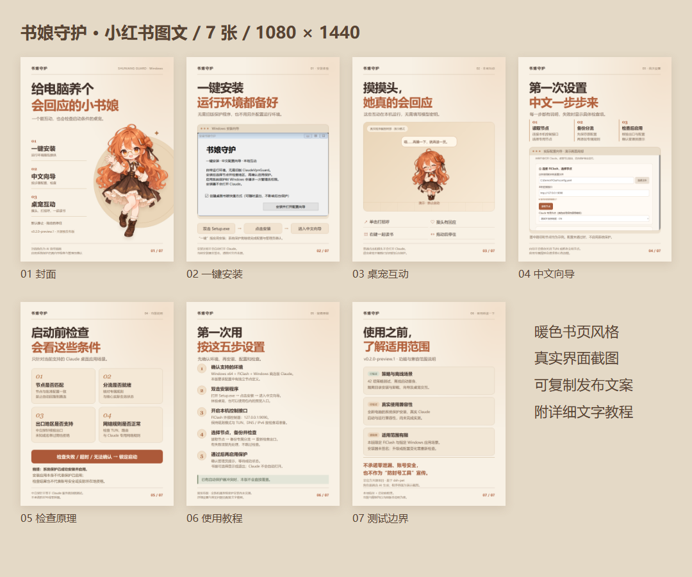

# 图文素材

[下载图文包](https://github.com/Eclipse017/ShuniangGuard/releases/download/v0.2.0-preview.1/ShuniangGuard-Promo-v0.2.0.zip) · [复制标题与正文](COPY.md) · [使用教程](../USER-GUIDE.md)

7 张 1080 × 1440 PNG，按编号使用。素材包包含图片、标题、正文和简单教程，可直接用于图文介绍。

| 顺序 | 图片 |
| --- | --- |
| 01 | [封面](../media/01-cover.png) |
| 02 | [一键安装](../media/02-install.png) |
| 03 | [桌宠互动](../media/03-interaction.png) |
| 04 | [中文向导](../media/04-wizard.png) |
| 05 | [检查原理](../media/05-checks.png) |
| 06 | [使用教程](../media/06-tutorial.png) |
| 07 | [适用范围](../media/07-scope.png) |

封面角色为 AI 宣传插画；功能图使用程序演示截图，示例路径与节点不是实际用户配置。

图文对应 0.2.0-preview.1。介绍功能时请保留预发布状态与适用范围，不作防封号、零泄漏或账号安全承诺。

[素材与许可](../../NOTICE.md) · [返回首页](../../README.md)
